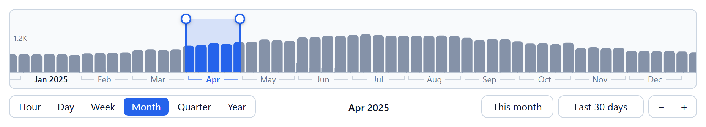

# Svelte Time Range

[](https://www.npmjs.com/package/svelte-time-range)
[](https://github.com/elebree/svelte-time-range/actions/workflows/ci.yml)
[](https://codecov.io/gh/elebree/svelte-time-range)
[](https://elebree.github.io/svelte-time-range/)
[](LICENSE)

A zoomable, time-zone aware time range slider for Svelte 5: pick a period on a timeline, e.g. to
filter a map or a list by time.

<a href="https://elebree.github.io/svelte-time-range/">
  <picture>
    <source media="(prefers-color-scheme: dark)" srcset="https://raw.githubusercontent.com/elebree/svelte-time-range/main/images/preview-dark.png">
    
  </picture>
</a>

**[Try the live demo →](https://elebree.github.io/svelte-time-range/)**

- **Zoom and scroll** the timeline from minutes to decades: drag, wheel, pinch.
- **Calendar-aware**: one-click hour … year presets, _This month_ / _Last 30 days_, edges snap to
  ticks, and a dragged month stays a whole month.
- **Any IANA time zone**, daylight-saving days included. No date library, just `Intl`.
- **Chart of your data** on the ruler (bars or line), with the selection highlighted.
- **17 languages**, light and dark, keyboard and screen-reader accessible, phone-friendly.

## Install

```sh
npm install svelte-time-range
```

## Usage

```svelte
<script lang="ts">
	import { TimeRangeSlider, presetRange, type TimeRangeChange } from 'svelte-time-range';

	const timeZone = 'Europe/Berlin';
	let { from, to } = $state(presetRange('month', { timeZone }));

	function onchange({ from, to }: TimeRangeChange) {
		// Called once per finished interaction: a good moment to reload or refilter data.
	}
</script>

<TimeRangeSlider bind:from bind:to {timeZone} locale="de-DE" {onchange} />
```

The range is half-open: `from` is included, `to` is not, so April is `2025-04-01` → `2025-05-01`.

### Props

| Prop         | Default        | Description                                                                                                                                                                              |
| ------------ | -------------- | ---------------------------------------------------------------------------------------------------------------------------------------------------------------------------------------- |
| `from`, `to` | current month  | The selected range (`Date`). Bindable.                                                                                                                                                   |
| `timeZone`   | runtime zone   | IANA zone for calendar math and labels, e.g. `'UTC'`.                                                                                                                                    |
| `locale`     | runtime locale | Dates, numbers, UI language and first day of the week.                                                                                                                                   |
| `min`, `max` | –              | Limits of the timeline (`Date`).                                                                                                                                                         |
| `presets`    | all            | Preset buttons to show, e.g. `['day', 'week', 'month']`; `[]` hides them.                                                                                                                |
| `toolbar`    | `true`         | Show the toolbar below the ruler.                                                                                                                                                        |
| `ruler`      | `'always'`     | `'popover'` or `'toggle'`: only the toolbar, its range text opens the ruler. Handy over a map on phones. A popover closes on a press outside, a toggle stays open; both close on Escape. |
| `disabled`   | `false`        |                                                                                                                                                                                          |
| `onchange`   | –              | After a finished interaction (drag released, key, button).                                                                                                                               |
| `oninput`    | –              | On every intermediate value while dragging.                                                                                                                                              |
| `data`       | –              | `{ time, value? }[]` to draw as a chart. Without `value` a point counts 1.                                                                                                               |
| `chart`      | `'bar'`        | `'bar'` or `'line'`.                                                                                                                                                                     |
| `aggregate`  | `'sum'`        | `'sum'`, `'mean'`, `'min'` or `'max'` per bucket.                                                                                                                                        |
| `valueLabel` | –              | Unit shown after values, e.g. `'events'`.                                                                                                                                                |

Less common props (`weekStartsOn`, `step`, `minDuration`, `snapThreshold`, `minViewSpan`,
`maxViewSpan`, `labels`, `formatRange`, `formatValue`, `expanded`) are documented in the
TypeScript types and show up in your editor.

Methods are available through `bind:this`, for example `slider.shift(1)` for the next period or
`slider.reveal()` to scroll the selection into view.

### Localization

English, German, French, Spanish, Italian, Portuguese, Dutch, Polish, Czech, Swedish, Turkish,
Russian, Ukrainian, Japanese, Korean and Chinese (Simplified and Traditional) are built in and
picked from `locale`. Override single strings with `labels`:

```svelte
<TimeRangeSlider locale="fr-FR" labels={{ presets: { month: 'Mensuel' } }} />
```

### Theming

The slider follows the page's `color-scheme`. Adjust it with CSS custom properties:

```css
.my-slider {
	--trs-accent: #0d9488;
	--trs-selection: rgb(13 148 136 / 0.15);
	--trs-height: 64px;
}
```

Also available: `--trs-accent-contrast`, `--trs-text`, `--trs-muted`, `--trs-border`,
`--trs-surface`, `--trs-track-background`, `--trs-tick`, `--trs-now`, `--trs-chart`,
`--trs-chart-muted`, `--trs-radius`, `--trs-font-size`.

With `ruler="popover"` or `"toggle"` the slider is a floating card. On phones, give the ruler
the whole width by docking the card to the bottom edge:

```css
@media (max-width: 680px) {
	.map-control {
		inset: auto 0 0;
		--trs-card-padding: 8px max(8px, env(safe-area-inset-right))
			calc(8px + env(safe-area-inset-bottom)) max(8px, env(safe-area-inset-left));
		--trs-card-border-width: 1px 0 0;
		--trs-card-radius: 12px 12px 0 0;
	}
}
```

A year then shows all 12 month names ("Jan", "Feb" …) on phones from about 390 px wide.

### Server-side rendering

Works out of the box. Pass explicit `timeZone`, `locale`, `from` and `to` so the server and the
browser render the same text.

## Development

```sh
pnpm install
pnpm dev            # demo with hot reload
pnpm test:unit      # unit and component tests (watch mode)
pnpm test:e2e       # end-to-end tests against the built demo
pnpm lint && pnpm check
```

Tool versions are pinned in `mise.toml` (`mise install`, then `mise tasks` lists shortcuts).

## License

[MIT](LICENSE)
